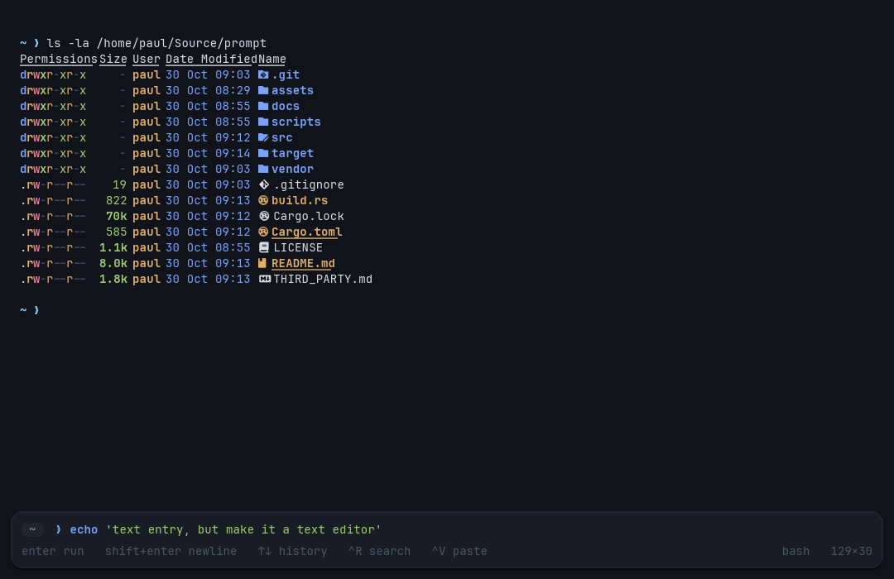

# Prompt

**A terminal that types like an editor.**

Prompt is a macOS/Linux terminal for people who live in AI-assisted
development but still need a real shell. It looks like a terminal, but the
command line is a proper text editor: click anywhere to place the caret, drag
to select, copy and paste with the shortcuts you already know, syntax
highlighting, multiline commands, history search and completion.

The terminal engine is [Ghostty's `libghostty-vt`](https://github.com/ghostty-org/ghostty).
Prompt embeds it directly, so VT parsing, scrollback, selection, key encoding
and semantic prompt tracking are Ghostty's, not a reimplementation.



## Download

Release builds support the two latest macOS versions on Apple Silicon:

- [Prompt for macOS 26 (arm64)](https://github.com/paul-oms/prompt/releases/latest/download/Prompt-macos-26-arm64.dmg)
- [Prompt for macOS 27 (arm64)](https://github.com/paul-oms/prompt/releases/latest/download/Prompt-macos-27-arm64.dmg)

The DMGs are ad-hoc signed but not notarized yet. If macOS blocks the first
launch, right-click **Prompt.app**, choose **Open**, then confirm.

## What works

- **Editor-grade command entry** — selection, click-to-place caret, word and
  line movement, cut/copy/paste, undo/redo, smart Home, multiline commands,
  syntax highlighting.
- **A calm first screen** — Prompt opens as a single command line centred in
  the window. Running your first command slides it to the bottom and fades in
  the terminal.
- **Real terminal behaviour** — vim/nvim, less, top, ssh, tmux and other
  full-screen programs get the keyboard while they run. Prompt switches back
  to the composer when the shell prompt returns.
- **Command blocks** — every submitted command is marked in the scrollback
  with its exit status. Scroll through earlier commands, or jump between
  blocks with `Cmd/Ctrl+Shift+↑/↓`. Open a dedicated block view with
  `Cmd/Ctrl+Shift+B`: long blocks show a 300-line window that expands on
  demand, `g`/`G` snaps to the top or bottom, and `/` searches the block.
- **Background commands** — push a long-running command into the side panel
  with the card's **background** button or `Cmd/Ctrl+Shift+D`. The panel shows
  the command, its elapsed time and last output line; scroll the list with the
  mouse wheel when there are more tabs than fit. Click the entry to bring it
  back, or the **×** to stop it.
- **Ghost autocomplete** — dim suggestions from history and `PATH` appear as
  you type; `Right` at the end of the line accepts them. `Tab` completes the
  token, or opens the full completion popup when several candidates match;
  move through the list with `Up`/`Down` (or `Shift+Tab`/`Tab`) and accept with
  `Enter`.
- **Ghostty VT core** — true-colour, scrollback, alternate screen, wide
  characters and emoji, mouse reporting, bracketed paste, semantic prompts.
- **Zero-config first run** — Prompt writes its config, shell integration and
  history files itself. It sources your existing zsh/bash configuration; it
  does not modify your dotfiles.
- **History that is discoverable** — Up/Down recall and a filtered history
  search (`Cmd/Ctrl+R`) with a visual picker.
- **Themes and fonts** — opinionated dark theme, automatic monospace font
  selection, one `config.toml` to change them.

## Install / run

Requirements: Rust (stable), and on Linux a windowing system (X11 or Wayland).
The vendored libghostty-vt bindings are generated C headers, so a C compiler or
libclang is only needed if you rebuild the VT library or regenerate bindings.

```sh
cargo run --release
```

The first launch creates:

```
~/.config/prompt/config.toml          # optional settings
~/.config/prompt/shell/                # zsh/bash integration + shims
~/.local/share/prompt/history.jsonl    # command history
```

No shell setup is required. Prompt prefers, in order:

1. `vendor/zsh/bin/zsh` (a shell bundled next to Prompt)
2. system `zsh`
3. system `bash`
4. `$SHELL`

Both zsh and bash get the integration automatically. Other shells run in
classic-passthrough mode, where the composer explains that the shell is not
integrated.

### Bundled zsh

Release builds can ship zsh next to the executable:

```sh
scripts/vendor-zsh.sh /usr          # or any zsh prefix
```

This copies `bin/zsh`, `lib/zsh` and `share/zsh` into `vendor/zsh`. Prompt
detects that layout, fixes up zsh's module/function search paths, and launches
the bundled shell. The repository does not commit a zsh binary; packaging
should run the script (or build a static zsh) as part of the release.

### Building the Ghostty VT library

A prebuilt `libghostty-vt` for x86_64 Linux is vendored in
`vendor/ghostty-vt/`. To rebuild it for your machine (required for macOS and
ARM Linux, or to update Ghostty):

```sh
scripts/build-ghostty-vt.sh
```

The script downloads Zig 0.17.0 and Ghostty, builds the C library and copies
the headers/static library into `vendor/ghostty-vt/`. You need `curl`, `tar`
and network access. `src/ghostty_bindings.rs` is pre-generated from the
vendored headers; regenerate it with bindgen if you change the Ghostty
version.

On macOS the same Rust stack is used (winit + softbuffer + cosmic-text); only
the Ghostty static library needs a macOS build.

## Keyboard

Prompt is designed for both macOS and Linux. `Cmd` means `Cmd` on macOS and
`Ctrl` means `Ctrl` on Linux.

| Action | macOS | Linux |
| --- | --- | --- |
| Run command | `Enter` | `Enter` |
| New line | `Shift+Enter` | `Shift+Enter` |
| Previous / next history or completion | `Up` / `Down` | `Up` / `Down` |
| Search history | `Cmd+R` | `Ctrl+R` |
| Complete / cycle suggestions | `Tab` / `Shift+Tab` | `Tab` / `Shift+Tab` |
| Accept suggestion | `Right` at end of line | `Right` at end of line |
| Copy | `Cmd+C` (or `Ctrl+Shift+C` in a running program) | `Ctrl+Shift+C` |
| Paste | `Cmd+V` | `Ctrl+V` in the composer, `Ctrl+Shift+V` while a program runs |
| Cut | `Cmd+X` | `Ctrl+X` |
| Select all | `Cmd+A` | `Ctrl+A` |
| Undo / redo | `Cmd+Z` / `Cmd+Shift+Z` | `Ctrl+Z` / `Ctrl+Shift+Z` |
| Word left / right | `Option+←/→` | `Ctrl+←/→` |
| Line start / end | `Cmd+←/→` | `Home` / `End` |
| Delete word | `Option+Backspace` | `Ctrl+Backspace` |
| Delete to line start | `Cmd+Backspace` | `Ctrl+U` |
| Interrupt / clear line | `Ctrl+C` | `Ctrl+C` |
| Clear screen | `Cmd+K` | `Ctrl+L` |
| Scroll terminal | `Shift+PageUp/Down`, wheel | same |
| Previous / next command block | `Cmd+Shift+↑/↓` | `Ctrl+Shift+↑/↓` |
| Open / close block view | `Cmd+Shift+B` | `Ctrl+Shift+B` |
| Move running command to background | `Cmd+Shift+D` | `Ctrl+Shift+D` |
| Fullscreen | `F11`, `Cmd+Ctrl+F` | `F11` |
| Zoom font | `Cmd+=` / `Cmd+-` / `Cmd+0` | `Ctrl+=` / `Ctrl+-` / `Ctrl+0` |

In the terminal grid: click and drag to select, double-click a word,
triple-click a line, then copy. While a TUI has mouse reporting enabled,
Prompt forwards clicks, releases and wheel events; hold `Shift` to select
text instead.

In block view: `[`/`]` moves between blocks, `g`/`G` snaps to the top or
bottom, `e` expands a long block, `/` searches inside it, `n`/`N` walks the
matches, and `Esc` returns to the terminal.

## Configuration

`~/.config/prompt/config.toml` is created on first run. Everything has a
default; delete the file to start over.

```toml
[appearance]
font_family = ""      # empty = best installed monospace font
font_size = 14.0
line_height = 1.38

[behavior]
shell = ""            # empty = auto-detect
scrollback_lines = 10000
copy_on_select = false

[ui]
show_hints = true
inline_suggestions = true   # dim completion preview, accepted with Tab
start_maximized = false
window_width = 1080
window_height = 700
```

## How it works

```
src/
  app.rs        window, layout, input state machine, composer UI
  editor.rs     grapheme-aware text editor model (selection, undo, motion)
  term.rs       safe wrapper around libghostty-vt
  pty.rs        shell process + pseudo-terminal I/O
  shell.rs      zero-config shell discovery and integration shims
  font.rs       font discovery, shaping, glyph rasterisation
  render.rs     tiny-skia painter
  highlight.rs  shell syntax highlighting
  completion.rs PATH/history/filesystem completion
  history.rs    persistent, JSONL command history
  keys.rs       winit → Ghostty key encoding
```

Key design decisions:

- **Ghostty is the terminal.** `libghostty-vt` owns the grid, scrollback,
  screens, selection and VT parser. Prompt draws its render state.
- **The composer is the source of truth at the prompt.** Keys are not forwarded
  character-by-character; Prompt edits a real text buffer and sends the
  completed line on Enter. Shell prompt markers (OSC 133) tell Prompt when the
  shell is ready for input versus when a command owns the keyboard.
- **Your shell stays your shell.** Prompt launches a normal interactive
  zsh/bash with a shim `ZDOTDIR`/`--rcfile` that sources your real config and
  adds two hooks. Aliases, functions, version managers and prompts keep working.
- **No GPU required.** Rendering is CPU-side immediately-mode drawing with
  cosmic-text shaping; frames are only produced when something changes.

## Testing

```sh
cargo test
```

The test suite covers the editor model, shell syntax highlighting, history,
libghostty-vt integration (screens, selection, resize, semantic prompts, key
encoding) and a real zsh/bash prompt-marker round trip through a PTY.

UI smoke testing uses two developer environment hooks:

```sh
DISPLAY=:99 PROMPT_SCREENSHOT=/tmp/shot.png PROMPT_EXIT_AFTER_SCREENSHOT=1 \
  cargo run --release

# run a command automatically after the first prompt
PROMPT_AUTOTYPE='echo hello' PROMPT_AUTOTYPE_DELAY=1200 ...
```

## Roadmap

The prioritized backlog lives in [BACKLOG.md](BACKLOG.md). The current
sequence is:

1. **Daily driver** — macOS validation, IME polish, integration diagnostics,
   UI smoke tests, inline history suggestions.
2. **Legible terminal** — command blocks, history panel, command palette,
   shell-aware completion.
3. **Agent-aware** — detect Claude Code/Codex/OpenCode sessions, explain and
   fix failures, natural-language commands with a review step.
4. **Installable product** — Homebrew, Linux packages, signed macOS bundle,
   website and diagnostics.

## Third-party

Ghostty is MIT-licensed. See `vendor/ghostty-vt/LICENSE` and
`THIRD_PARTY.md`.

Prompt itself is MIT-licensed. See `LICENSE`.
