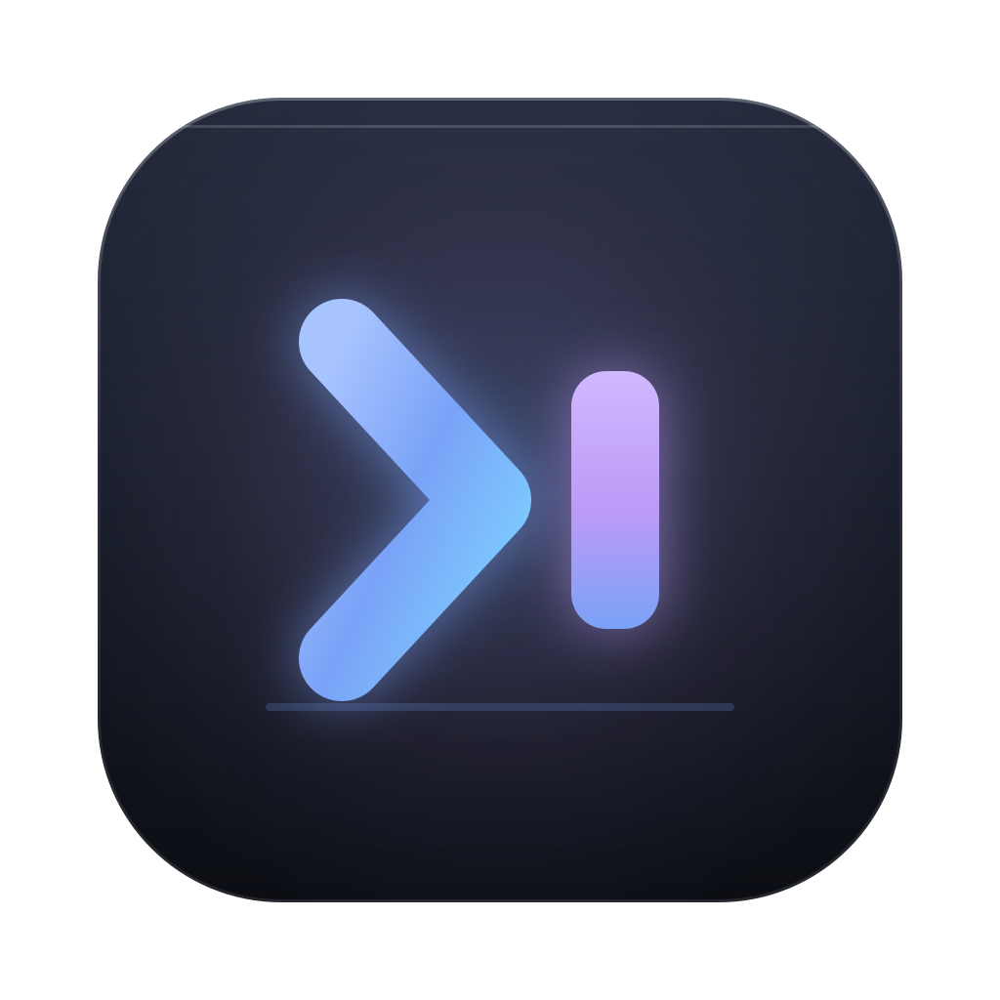
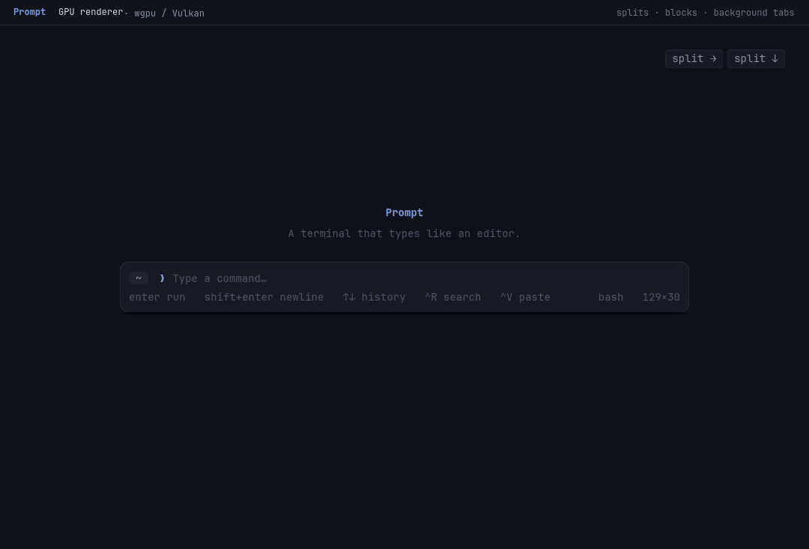

<p align="center">
  
</p>

# Prompt

**Prompt is a macOS/Linux terminal for people who enjoy polished, beautiful software.**

> [!WARNING]
> Prompt is **alpha software**. Expect rough edges, breaking changes and the
> occasional crash. It is only for the brave right now.

The command line is a proper text editor, and works precisely how you would expect it to work: click anywhere, drag
to select, copy and paste with the shortcuts you already know, complete with syntax
highlighting, multiline commands, history search, background terminals, and tab completion.

It's written in Rust and based on [libghostty](https://github.com/ghostty-org/ghostty). **Rendering is
GPU-accelerated** with [wgpu](https://wgpu.rs): glyphs, colours, cursor and chrome paint directly on the GPU, and a
software renderer takes over automatically when no usable adapter is present.

No configuration, no setup. It just works.



*The demo is painted live by Prompt's GPU path: run a command in the composer, split the pane, start a live command
in the second pane, park it in the background panel, then open block view beside it. The title strip is part of the
recording.*

**Highlights**

- **GPU rendering** — instanced glyphs and rectangles in one wgpu pass, with automatic CPU fallback.
- **Editor-grade composer** — click-to-edit, multiline commands, history search and tab completion.
- **Splits and background tabs** — run an agent and a shell side by side, or park long-running work.

## Download

Release builds support the two latest macOS versions on Apple Silicon:

- [Prompt for macOS 26 (arm64)](https://github.com/paul-oms/prompt/releases/latest/download/Prompt-macos-26-arm64.dmg)
- [Prompt for macOS 27 (arm64)](https://github.com/paul-oms/prompt/releases/latest/download/Prompt-macos-27-arm64.dmg)

The DMGs are ad-hoc signed but not notarized yet. If macOS blocks the first
launch, right-click **Prompt.app**, choose **Open**, then confirm.


## Install / run

Requirements: Rust (stable), and on Linux a windowing system (X11 or Wayland).
The vendored libghostty-vt bindings are generated C headers, so a C compiler or
libclang is only needed if you rebuild the VT library or regenerate bindings.

```sh
cargo run --release
```

The first launch creates:

```
~/.config/prompt/config.toml          # optional settings
~/.config/prompt/shell/                # zsh/bash integration + shims
~/.local/share/prompt/history.jsonl    # command history
```

No shell setup is required. Prompt prefers, in order:

1. `vendor/zsh/bin/zsh` (a shell bundled next to Prompt)
2. system `zsh`
3. system `bash`
4. `$SHELL`

Both zsh and bash get the integration automatically. Other shells run in
classic-passthrough mode, where the composer explains that the shell is not
integrated.

### Bundled zsh

Release builds can ship zsh next to the executable:

```sh
scripts/vendor-zsh.sh /usr          # or any zsh prefix
```

This copies `bin/zsh`, `lib/zsh` and `share/zsh` into `vendor/zsh`. Prompt
detects that layout, fixes up zsh's module/function search paths, and launches
the bundled shell. The repository does not commit a zsh binary; packaging
should run the script (or build a static zsh) as part of the release.

### Building the Ghostty VT library

A prebuilt `libghostty-vt` for x86_64 Linux is vendored in
`vendor/ghostty-vt/`. To rebuild it for your machine (required for macOS and
ARM Linux, or to update Ghostty):

```sh
scripts/build-ghostty-vt.sh
```

The script downloads Zig 0.17.0 and Ghostty, builds the C library and copies
the headers/static library into `vendor/ghostty-vt/`. You need `curl`, `tar`
and network access. `src/ghostty_bindings.rs` is pre-generated from the
vendored headers; regenerate it with bindgen if you change the Ghostty
version.

On macOS the same Rust stack is used (winit + wgpu + cosmic-text); only the
Ghostty static library needs a macOS build.

## Keyboard

Prompt is designed for both macOS and Linux. `Cmd` means `Cmd` on macOS and
`Ctrl` means `Ctrl` on Linux.

| Action | macOS | Linux |
| --- | --- | --- |
| Run command | `Enter` | `Enter` |
| New line | `Shift+Enter` | `Shift+Enter` |
| Previous / next history or completion | `Up` / `Down` | `Up` / `Down` |
| Search history | `Cmd+R` | `Ctrl+R` |
| Complete / cycle suggestions | `Tab` / `Shift+Tab` | `Tab` / `Shift+Tab` |
| Accept suggestion | `Right` at end of line | `Right` at end of line |
| Copy | `Cmd+C` (or `Ctrl+Shift+C` in a running program) | `Ctrl+Shift+C` |
| Paste | `Cmd+V` | `Ctrl+V` in the composer, `Ctrl+Shift+V` while a program runs |
| Cut | `Cmd+X` | `Ctrl+X` |
| Select all | `Cmd+A` | `Ctrl+A` |
| Undo / redo | `Cmd+Z` / `Cmd+Shift+Z` | `Ctrl+Z` / `Ctrl+Shift+Z` |
| Word left / right | `Option+←/→` | `Ctrl+←/→` |
| Line start / end | `Cmd+←/→` | `Home` / `End` |
| Delete word | `Option+Backspace` | `Ctrl+Backspace` |
| Delete to line start | `Cmd+Backspace` | `Ctrl+U` |
| Interrupt / clear line | `Ctrl+C` | `Ctrl+C` |
| Clear screen | `Cmd+K` | `Ctrl+L` |
| Scroll terminal | `Shift+PageUp/Down`, wheel | same |
| Previous / next command block | `Cmd+Shift+↑/↓` | `Ctrl+Shift+↑/↓` |
| Open / close block view | `Cmd+Shift+B` | `Ctrl+Shift+B` |
| Split pane right | `Cmd+Shift+D` | `Ctrl+Shift+D` |
| Split pane down | `Cmd+Shift+E` | `Ctrl+Shift+E` |
| Move focus between panes | `Cmd+Shift+←/→/↑/↓` | `Ctrl+Shift+←/→/↑/↓` |
| Zoom pane | `Cmd+Shift+Enter` | `Ctrl+Shift+Enter` |
| Close pane | `Cmd+Shift+W` | `Ctrl+Shift+W` |
| Move running command to background | `Cmd+Shift+M` | `Ctrl+Shift+M` |
| Fullscreen | `F11`, `Cmd+Ctrl+F` | `F11` |
| Zoom font | `Cmd+=` / `Cmd+-` / `Cmd+0` | `Ctrl+=` / `Ctrl+-` / `Ctrl+0` |

In the terminal grid: click and drag to select, double-click a word,
triple-click a line, then copy. While a TUI has mouse reporting enabled,
Prompt forwards clicks, releases and wheel events; hold `Shift` to select
text instead.

Split panes have a slim header with visible split, zoom and close buttons, so
the feature is reachable without memorising shortcuts. Drag the divider to
resize; each pane keeps its own shell, cwd, composer and command blocks. The
background panel is shared by the whole window, so parked commands stay put
while you split and focus panes. While splits are open, `Cmd/Ctrl+Shift+↑/↓`
moves focus instead of jumping between command blocks; close the split (or use
block view) to browse blocks.

In block view: `[`/`]` moves between blocks, `g`/`G` snaps to the top or
bottom, `e` expands a long block, `/` searches inside it, `n`/`N` walks the
matches, and `Esc` returns to the terminal.

## Configuration

`~/.config/prompt/config.toml` is created on first run. Everything has a
default; delete the file to start over.

```toml
[appearance]
font_family = ""      # empty = best installed monospace font
font_size = 14.0
line_height = 1.38

[behavior]
shell = ""            # empty = auto-detect
scrollback_lines = 10000
copy_on_select = false

[ui]
show_hints = true
inline_suggestions = true   # dim completion preview, accepted with Tab
start_maximized = false
window_width = 1080
window_height = 700

[render]
backend = "auto"      # auto (GPU when available), gpu, or cpu
```

## GPU rendering

Prompt paints rectangles and glyphs directly on the GPU through wgpu (Vulkan on
Linux, Metal on macOS). Glyph masks and colour emoji live in a shared atlas;
rectangles, borders and text are uploaded as instance data and drawn in a single
ordered pass, so the GPU handles the per-frame work while the CPU only lays out
changed text. The software renderer remains as a fallback for machines without a
usable adapter.

- `backend = "auto"` (the default) uses the GPU when one is available and falls
  back to software.
- `backend = "gpu"` asks for the GPU explicitly; if initialisation fails Prompt
  still starts with the software renderer.
- `backend = "cpu"` forces the tiny-skia/softbuffer path.

For troubleshooting, `PROMPT_RENDER=cpu` or `PROMPT_RENDER=gpu` overrides the
config for a single run, and Prompt prints the chosen adapter to stderr at
startup.

[`scripts/demo.sh`](scripts/demo.sh) is a small GPU stress sequence for local
testing: coloured scrollback followed by a full-screen truecolour animation.

## Testing

```sh
cargo test
```

The test suite covers the editor model, shell syntax highlighting, history,
libghostty-vt integration (screens, selection, resize, semantic prompts, key
encoding) and a real zsh/bash prompt-marker round trip through a PTY.

UI smoke testing uses two developer environment hooks:

```sh
DISPLAY=:99 PROMPT_SCREENSHOT=/tmp/shot.png PROMPT_EXIT_AFTER_SCREENSHOT=1 \
  cargo run --release

# run a command automatically after the first prompt
PROMPT_AUTOTYPE='echo hello' PROMPT_AUTOTYPE_DELAY=1200 ...
```

## Third-party

Ghostty is MIT-licensed. See `vendor/ghostty-vt/LICENSE` and
`THIRD_PARTY.md`.

Prompt itself is MIT-licensed. See `LICENSE`.
